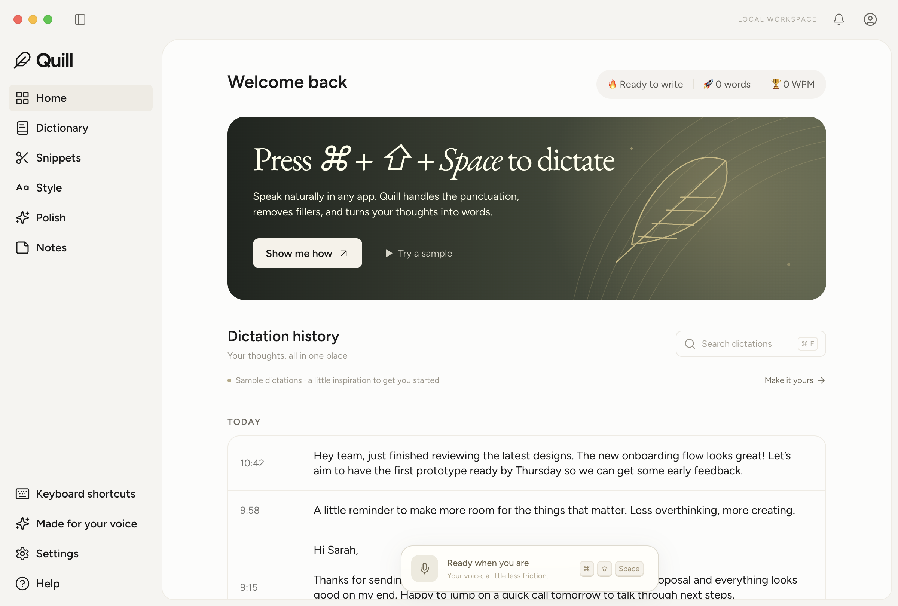
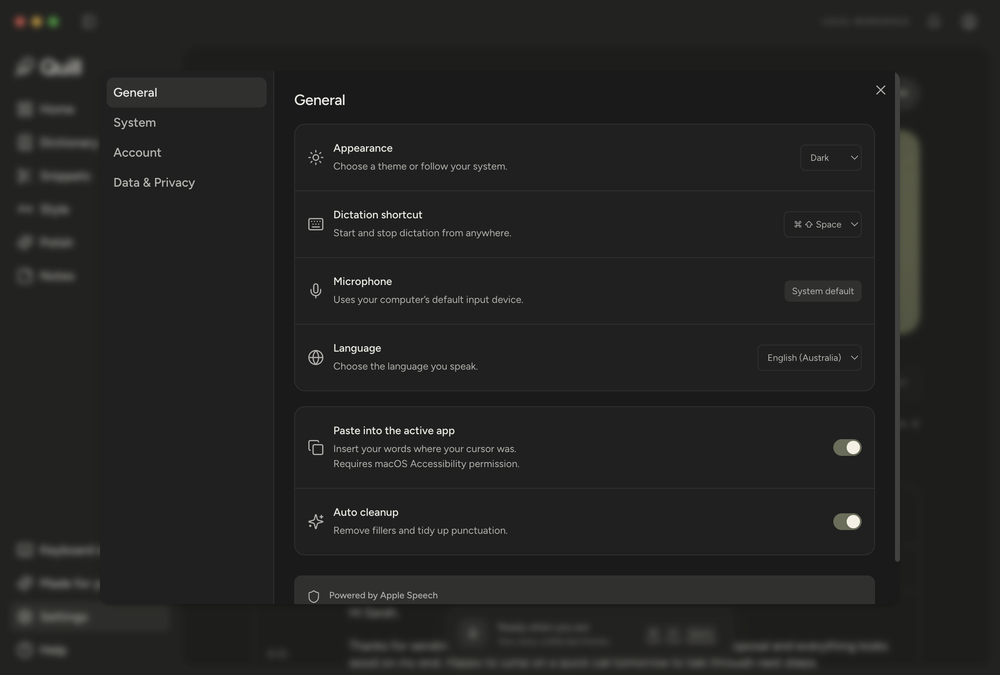

# Wispr Flow visual reference alignment

Compared on 19 October 2026 using **REA 6.7.0**, against the public Apple Silicon **Wispr Flow 1.6.1174** desktop package. Quill retains its own branding and implementation.

**Status: the measured shared layout is aligned; complete visual parity is not established.** These checks are computed-style comparisons against an inert fixture built from shipped CSS, not a signed-in Wispr app screenshot or a pixel-difference score.

## What changed

| Shared layout | Previous Quill | Reference and updated Quill |
| --- | --- | --- |
| Title bar | 50px | 52px |
| Sidebar | 228px | 216px |
| Collapsed sidebar | 72px | 60px |
| Navigation row | 42px, radius 10px | 36px, radius 6px |
| Navigation typography | 15px, browser-normal line height | 15px / 20px, weight 550 |
| Main panel | top 50px; bottom extended off-screen | top 52px; bottom inset 8px |
| Main panel corners | 26px top, square bottom | 24px top, 16px bottom |
| Desktop content inset | 58px top, asymmetric horizontal padding | 40px top and sides; centered content capped at max(800px,50vw) |
| Page title | 25–26px | 24px / 32px, weight 600 |
| History time column | 119px | 98px, padding 16px |
| History text | 14px / 23px | 15px / 20px |
| History and library table corners | 17px / 14px | 16px |
| Library rows | minimum 73px, 13px type | minimum 52px, 15px / 20px type |
| Settings | full page | 960 × 640 dialog, radius 12px, 209px navigation |
| Dark surfaces | olive-tinted | neutral #202020 shell and #1a1a1a content |

The latest reference history row displays time without a destination-app subtitle; Quill now uses that compact presentation. App attribution is retained in stored history and the detail view.

Settings keeps Quill’s Appearance and permission controls. Its content scrolls, Escape and backdrop clicks close it, and the background is inert while a dialog is open. Cmd/Ctrl+F cannot move focus into the background history search.

## Verification

`npm run test:visual` builds and launches an isolated renderer with synthetic sample data. It does not install Quill, invoke the speech helper, record audio, or change OS permissions.

- **151 reference-layout assertions passed on macOS**: 49 shared properties at each of 1200×810/light, 960×810/dark, and 1440×810/dark, plus four Settings measurements.
- Dialog focus isolation and Escape dismissal passed at all three widths.
- The existing 22 unit/lifecycle tests and production build passed.
- Home, Dictionary, Snippets, light Settings, and dark Settings were captured for visual inspection. Screenshots below show Quill, not the reference application.
- The same layout check is included in the Windows build workflow; see the associated CI result for Windows verification.

The expected values are stored in [the reference measurement fixture](../tests/fixtures/wispr-layout.json). They are external-reference facts rather than values read back from Quill’s own source.

## Evidence and limits

REA analyzed the shipped ASAR’s manifest, hub HTML, hub renderer, and preload without executing them. Additional inert TypeScript AST parsing recovered CSS literal/template contents and their exported class maps. Electron rendered the selected styles in a small, explicitly reconstructed fixture; Quill’s real renderer was measured separately. [Evidence identities and digests](visual-parity-evidence.json) identify both inputs. No Wispr source, proprietary banner, or extracted stylesheet is included in this repository.

The download’s complete app signature verified successfully. REA separately found ASAR-declared hash contradictions for three unpacked native files (SQLite, Jabra connector, panel activation). Analysis recorded those bytes as untrusted with `record-and-continue`; native files were not executed or used as visual evidence. The selected-source analysis leaves 179 files outside scope, and bounded semantic graphs do not establish complete runtime behavior.

Not verified: authenticated Wispr screenshots; account/plan-dependent panels; full Home/banner and Settings-content composition; overlays and recording states; Windows native chrome pixel parity; full responsive/mobile parity; proprietary speech/AI/cloud features. No blanket “1:1” claim is made.

Intentional differences remain: Quill name and feather logo, original SVG banners, local sample history and notices, local permission UI, and Quill-only features. Artwork, text, data, and available features prevent full-image equality even when shared geometry matches.

## Quill screenshots

